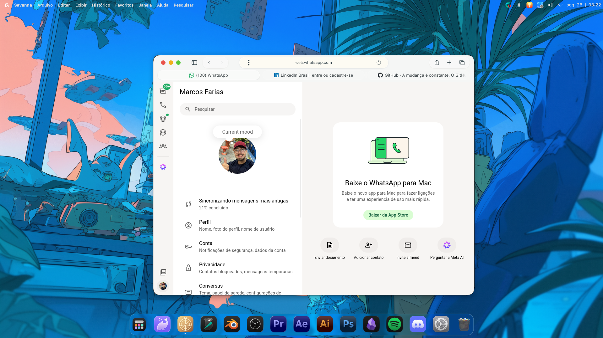
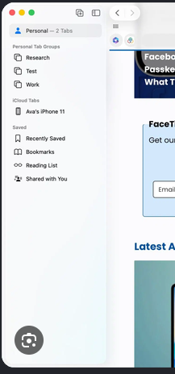
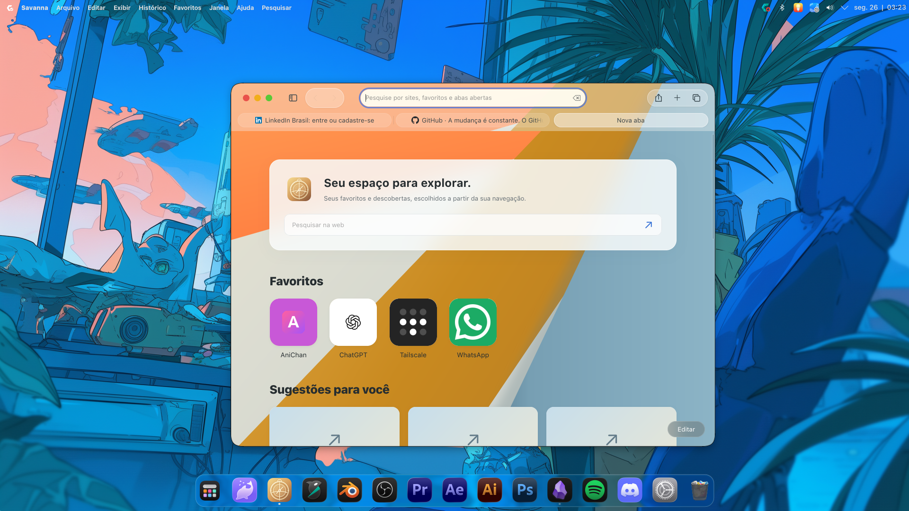
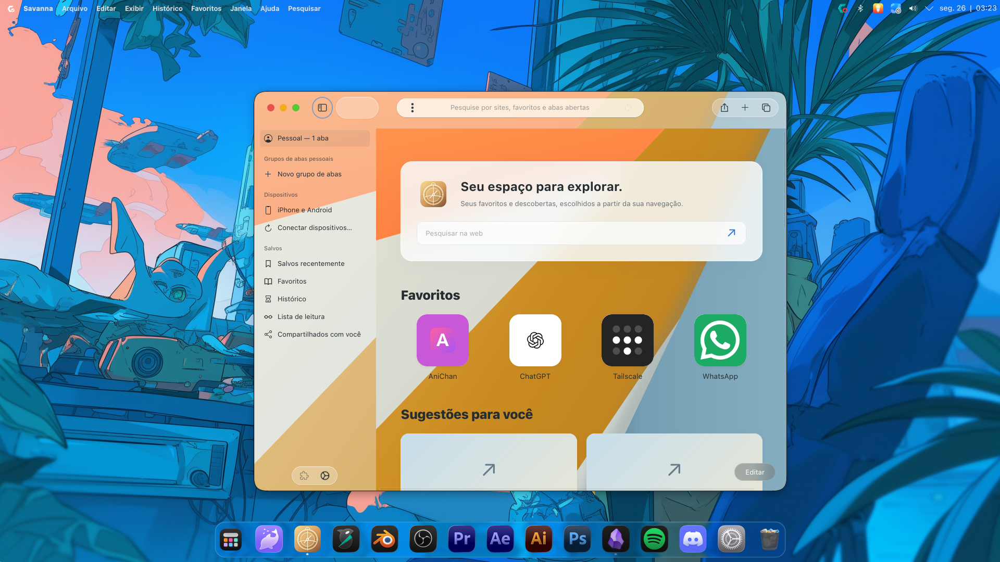
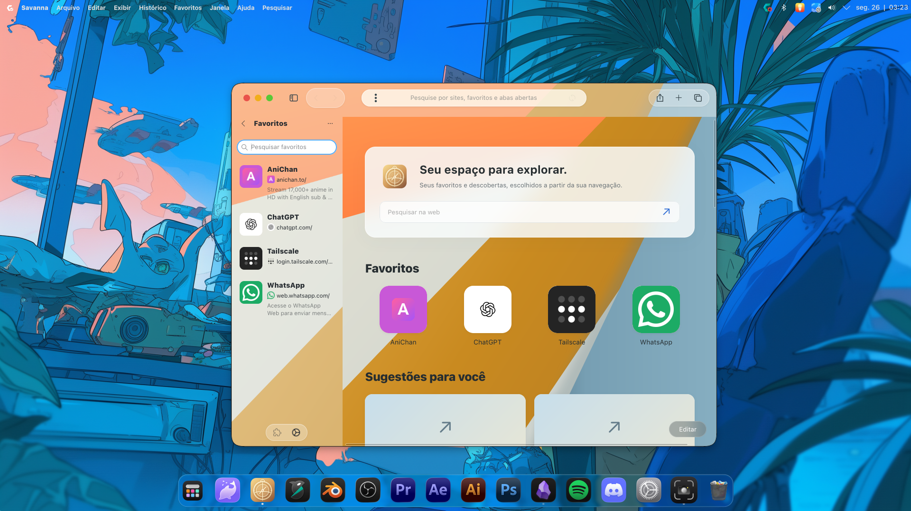
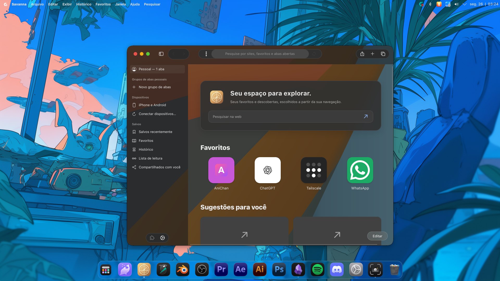
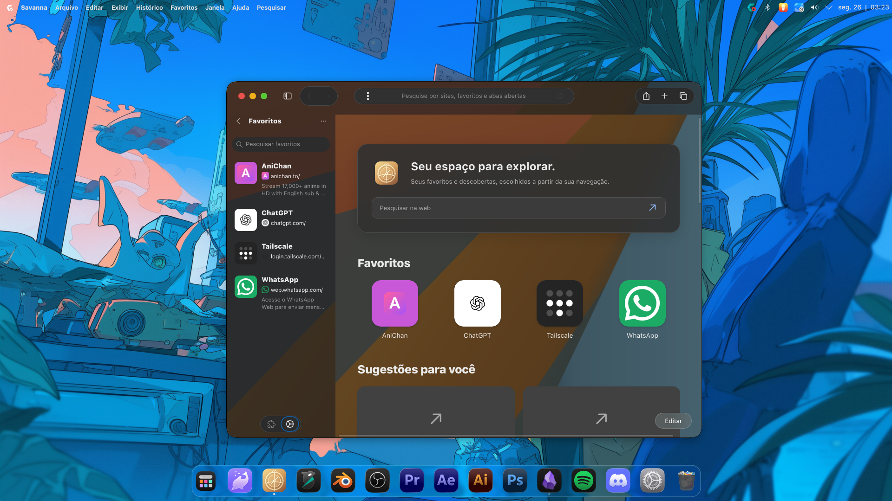
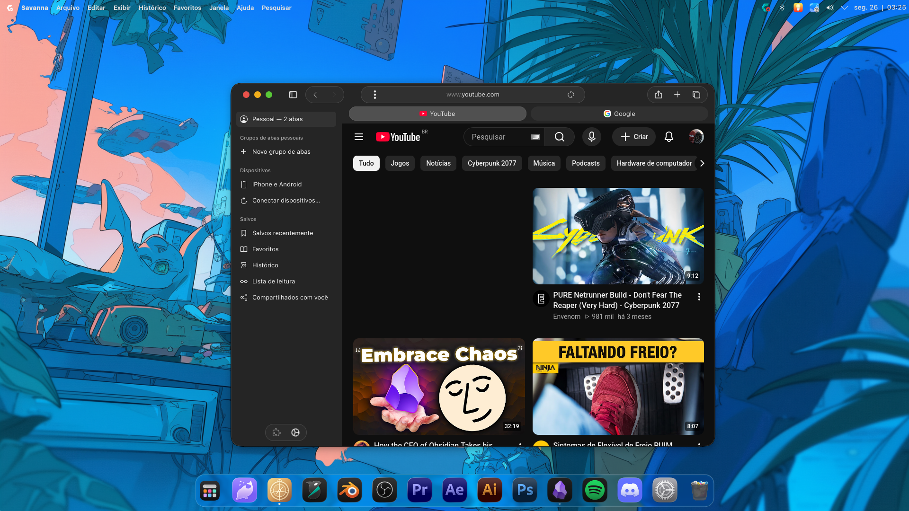
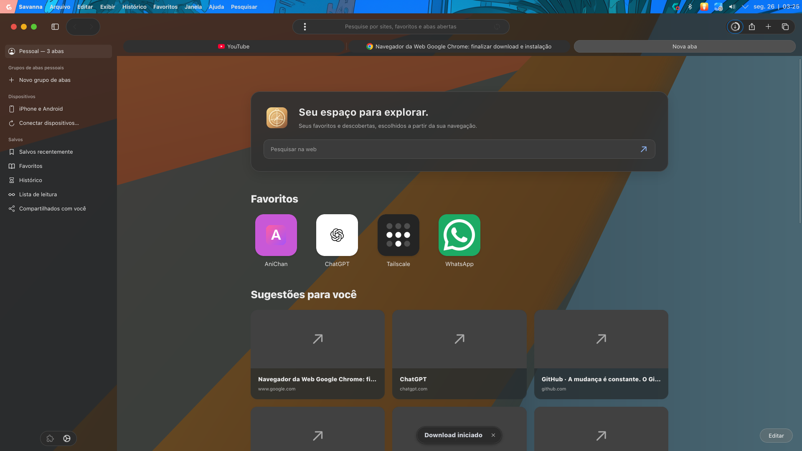

# Savanna

**Savanna** is a Linux web browser based on GNOME Web (Epiphany) and WebKitGTK. It builds on Epiphany's browsing engine while providing its own interface, with tab groups, a sidebar, saved content, and KDE Plasma global menu support.

The installed application is called **`savanna`**. It has its own application ID (`com.savanna.Browser`) and does not install an executable named `epiphany`.

## Screenshots

| Browser | Sidebar |
| --- | --- |
|  |  |

| Screenshot | Screenshot | Screenshot |
| --- | --- | --- |
|  |  |  |
|  |  |  |



## Easy Linux installation

### CachyOS and Arch Linux

Install the build tools and GTK/WebKit dependencies:

```sh
sudo pacman -S --needed base-devel git meson ninja pkgconf \
  gtk4 libadwaita webkitgtk-6.0 dbusmenu-glib wayland libx11
```

Clone, build, and install for your user (installation does not require `sudo`):

```sh
git clone https://github.com/marcosfantonio/savanna.git savanna-browser
cd savanna-browser
meson setup build --prefix="$HOME/.local" -Ddeveloper_mode=true
meson install -C build --quiet
```

If Meson reports a missing dependency, install the corresponding development package with `pacman` and run `meson setup`/`meson install` again. Meson lists the global menu integrations enabled in its summary.

Launch the browser from a terminal:

```sh
~/.local/bin/savanna
```

The installed `.desktop` file also adds Savanna to the Plasma application launcher. If commands installed in `~/.local/bin` are not on your `PATH`, add that directory or use the full path shown above.

### Other distributions

Install the development dependencies for GTK 4, libadwaita, WebKitGTK 6, Meson/Ninja, and the libraries required by the project; package names vary by distribution. Then use the same clone, setup, and installation commands above. Meson will stop during configuration and identify any missing dependency.

## Rebuild

From the repository directory, run:

```sh
meson install -C build --quiet
```

This recompiles changed files and installs the application again in `~/.local`. To run the interface tests:

```sh
meson test -C build 'Savanna interface test' --print-errorlogs
```

## Features

- Persistent tab groups in the sidebar.
- History, bookmarks, and saved content accessible from the interface.
- Device tab integration through Firefox Sync.
- Plasma global menu integration via DBusMenu on Wayland and X11/XWayland, when the global-menu panel is enabled.
- A height-limited downloads popover with its own scrolling.

See [`docs/global-menu.md`](docs/global-menu.md) for global menu compatibility and troubleshooting, and [`docs/architecture.md`](docs/architecture.md) for UI organization and guidance for future changes. Coding agent instructions are in [`AGENTS.md`](AGENTS.md).

## Development

Savanna is free software licensed under GPL-3.0-or-later. Most modules still use the upstream Epiphany `ephy-*` internal names. Changes to Savanna's interface and project-specific integrations should follow the architecture and behaviors documented above.
